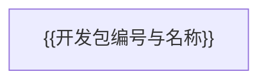

# {{项目名称}} 项目计划

更新：{{YYYY-MM-DD}}。设计见 [项目架构](项目架构.md)，已交付内容见 [项目记录](项目记录.md)。

当前目标：{{下一阶段应达成的结果。}}

## 活动开发包总表

| 开发包 | 优先级 | 状态 | 未完成依赖 | 交付与完成标志 |
| --- | --- | --- | --- | --- |
| {{编号与名称}} | {{优先级}} | {{状态}} | {{依赖或无}} | {{可验证结果}} |

## 依赖图

实线表示必须先完成的依赖；图中只保留活动开发包，与总表一致。

## 开发包说明

### {{编号}} · {{名称}}

- **交付**：{{预期结果。}}
- **完成标志**：{{验收方法、证据与允许声明。}}
- **边界**：{{不做什么，哪些操作须另行授权。}}

## 维护规则

开发包达到完成标志后，从总表、依赖图和活动正文移除，加入项目记录顶部，并刷新下游状态。未完成验收仍留在计划；已完成的阶段事实只记录，不复制实施过程。
