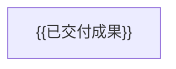

# {{项目名称}} 项目记录

活动工作见 [项目计划](项目计划.md)。按完成时间倒序组织，同日较晚交付在前；纠正历史时新增说明，不覆盖原结论。

## 交付总表

| 日期 | 开发包／阶段 | 交付结果 | 版本与证据 |
| --- | --- | --- | --- |
| {{YYYY-MM-DD}} | {{编号与名称；阶段交付明确标记}} | {{实际结果}} | {{提交或产物身份、证据入口}} |

## 已交付成果关系

只表示已交付成果之间的消费关系，不混入未完成依赖；阶段交付不等于开发包完成。

## {{YYYY-MM-DD}} · {{编号与名称}}

- **交付**：{{实际完成内容及其意义。}}
- **身份**：{{提交或产物版本；无提交时注明本机未提交，不虚构合入。}}
- **验证**：{{实际检查、结果与未覆盖范围。}}
- **限制**：{{仍有效的限制或待确认问题。}}
- **证据**：{{详细 Raw 或实际产物链接；不复制完整过程。}}
